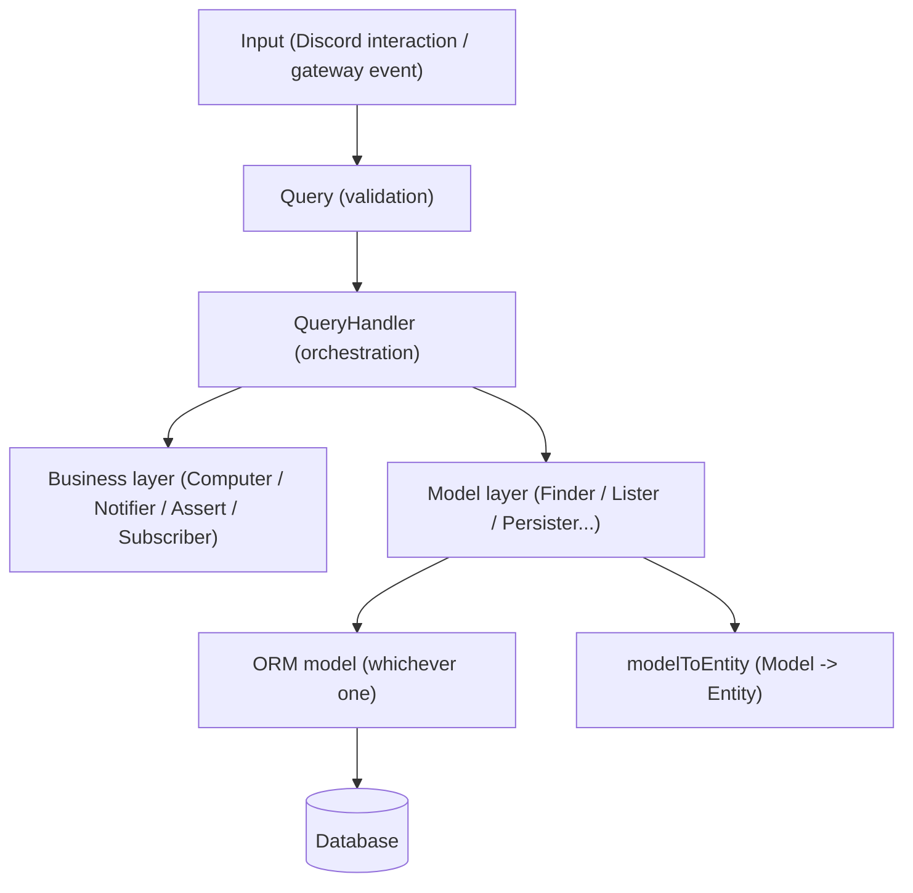

# Query-driven layered architecture

Strict layered separation using generic contracts (interfaces) reused throughout the code,
which makes each layer independently testable/mockable.

The running example below records a Discord user as a member of a guild (server), and whether
that member holds the server's admin role. It is fully backed by a database.

## Patterns in play

| Pattern                                       | Where it applies                                                                                                                       |
| --------------------------------------------- | -------------------------------------------------------------------------------------------------------------------------------------- |
| **Query object**                              | A `Query` encapsulates a request (read or write) as a validated object passed to a handler                                             |
| **Repository pattern**                        | `Finder`/`TryFinder`/`Lister`/`Persister`/`Remover`                                                                                    |
| **Ports & Adapters / hexagonal architecture** | The generic interfaces (`Finder<Entity>`...) are the _ports_; their concrete implementations are the _adapters_ that plug into the ORM |
| **Layered / Service Layer**                   | Handler → QueryHandler → business layer → Repository, in strictly descending layers                                                    |



Only the model layer (sections 4-5) knows about the ORM. Everything else (Query, QueryHandler,
business layer) only handles `Entity` objects and an opaque `Transaction` type — the ORM is
therefore interchangeable without touching the rest of the code.

There is a single input taxon: **Query**. A query may read state, write state, or both; the
distinction is expressed by which repository ports the handler uses (`Finder`/`Lister` vs
`Persister`/`Remover`), not by a separate `Command` type.

## 1. Query — input validation

A `Query` is a class that validates and carries data, without any business logic. It can represent
a read (`GetGuildMemberQuery`) or a write (`RecordGuildMemberQuery`).

`RecordGuildMemberQuery` is what a gateway `GUILD_MEMBER_ADD` / `GUILD_MEMBER_UPDATE` (or an
interaction that carries `member`) turns into: the Discord user, the server they belong to, and
the role ids currently on that member. Whether one of those roles is the admin role is **not**
decided here.

```typescript
type RecordGuildMemberPayload = {
  userId: string;
  guildId: string;
  username: string;
  roleIds: string[];
};

const schema: JSONSchemaType<RecordGuildMemberPayload> = {
  type: 'object',
  properties: {
    userId: { type: 'string', nullable: false },
    guildId: { type: 'string', nullable: false },
    username: { type: 'string', nullable: false },
    roleIds: {
      type: 'array',
      items: { type: 'string' },
      nullable: false,
    },
  },
  required: ['userId', 'guildId', 'username', 'roleIds'],
};

class RecordGuildMemberQuery {
  userId: string;
  guildId: string;
  username: string;
  roleIds: string[];

  constructor(
    payload: Record<string, unknown>,
    private callerId: string,
  ) {
    validatePayload(payload, schema, false); // fails fast if the payload is invalid
    this.userId = payload.userId;
    this.guildId = payload.guildId;
    this.username = payload.username;
    this.roleIds = payload.roleIds;
  }
}
```

- AJV or Zod validation (`validatePayload`) directly in the constructor → impossible to get an
  invalid instance.
- Can also carry the call context (`callerId`, the member's Discord role ids) for authorization.
- Read queries follow the same principle — e.g. `GetGuildMemberQuery { userId: string; guildId: string }`
  or `ListGuildMembersQuery { guildId: string; isAdmin?: boolean; offset?: number; limit?: number }`
  to list every member of a server, or only those who hold the admin role.

## 2. QueryHandler — orchestration

The handler never contains business rules or SQL. It receives its dependencies via constructor
injection (no DI container) and orchestrates: read the guild → compute whether this member is an
admin → transactional write (when the query mutates state).

```typescript
class RecordGuildMemberQueryHandler {
  constructor(
    private guildMemberRepository: Persister<GuildMember>,
    private guildRepository: Finder<Guild>,
    private guildMemberComputer: Computer<GuildMember, Guild>,
    private guildMemberNotifier: Notifier<GuildMember>,
  ) {}

  async handle(query: RecordGuildMemberQuery): Promise<GuildMember> {
    const guild = await this.guildRepository.findOrFail({
      guildId: query.guildId,
    });

    const member = this.buildMember(query);
    const computedMember = await this.guildMemberComputer.compute(
      member,
      guild,
    );

    await this.guildMemberRepository.persist(computedMember);

    await this.guildMemberNotifier.notify(computedMember);

    return computedMember;
  }

  private buildMember(query: RecordGuildMemberQuery): GuildMember {
    return {
      id: uuid(),
      userId: query.userId,
      guildId: query.guildId,
      username: query.username,
      roleIds: query.roleIds,
      isAdmin: false,
      joinedAt: new Date(),
      updatedAt: new Date(),
    };
  }
}
```

`isAdmin` starts as `false`. The computer is what turns the member's `roleIds` and the guild's
`adminRoleId` into the real answer: this user is on the server, and they either hold the admin
role or they do not.

A read-only query follows the exact same principle, but without a write or transaction. Callers
use it when they only need to know whether a user on that server is an admin:

```typescript
class GetGuildMemberQueryHandler {
  constructor(private guildMemberRepository: Finder<GuildMember>) {}

  async handle(query: GetGuildMemberQuery): Promise<GuildMember> {
    return this.guildMemberRepository.findOrFail({
      userId: query.userId,
      guildId: query.guildId,
    });
  }
}
```

Key points:

- Dependencies are typed by generic interface, never by concrete implementation → easy to stub in unit tests.
- A single dependency can compose multiple contracts: `Finder<GuildMember> & Persister<GuildMember>`.
- Multiple writes share a single transaction (`Transaction` is an opaque type, independent of the underlying ORM) passed as a parameter to every `persist`/`bulkPersist` call.
- `withTransaction` is a function provided by the model layer that opens/commits/rolls back the transaction, regardless of which ORM is used underneath.
- "Manual" instantiation in the interaction handler or the gateway processor (no IoC container):

```typescript
// src/gateway/handlers/recordGuildMemberHandler.ts
const recordGuildMemberHandler = async (event: GuildMemberEvent) => {
  const query = new RecordGuildMemberQuery(event.member, event.member.userId);
  const handler = new RecordGuildMemberQueryHandler(
    GuildMemberPersister,
    GuildFinder,
    new GuildMemberComputer(),
    guildMemberNotifier,
  );

  const member = await handler.handle(query);
  // member belongs to this server.
  // member.isAdmin is true only when one of their roles is the guild admin role.
};
```

## 3. Business layer — pure logic, no SQL

Always injected into the `QueryHandler`, never hardcoded inside it. Only handles `Entity`
objects (pure TS types in `src/entities/`), never a `Model`/record specific to the ORM.

| Contract                    | Role                                                        | Abstract shape                                                                                   |
| --------------------------- | ----------------------------------------------------------- | ------------------------------------------------------------------------------------------------ |
| `Computer<Entity, Context>` | Deterministic computation of a state                        | `compute(entity: Entity, context: Context): Promise<Entity>`                                     |
| `Notifier<Entity>`          | Side effect (Discord message, notification) after an action | `notify(entity: Entity): Promise<void>`                                                          |
| `Assert`                    | Authorization/validation guard                              | functions called before/within the handler, throw an error (`ForbiddenError`, `BadRequestError`) |
| `Subscriber<Entity>`        | Reacts to an event within the same transaction              | `subscribe(entity: Entity, transaction?: Transaction): Promise<void>`                            |

The computer is the only place that decides the admin role. A member of the guild whose
`roleIds` include `guild.adminRoleId` is an admin; any other member of that server is not.

```typescript
class GuildMemberComputer implements Computer<GuildMember, Guild> {
  public async compute(
    member: GuildMember,
    guild: Guild,
  ): Promise<GuildMember> {
    const isAdmin = member.roleIds.includes(guild.adminRoleId);
    return { ...member, isAdmin };
  }
}

function assertGuildMemberIsAdmin(member: GuildMember): void {
  if (!member.isAdmin) {
    throw new ForbiddenError('Admin role required on this server');
  }
}

class NotifyOnAdminRoleSubscriber implements Subscriber<GuildMember> {
  constructor(private notificationPersister: Persister<Notification>) {}

  public async subscribe(member: GuildMember, transaction?: Transaction) {
    if (!member.isAdmin) {
      return;
    }

    await this.notificationPersister.persist(
      this.buildNotification(member),
      transaction,
    );
  }
}
```

`Subscriber` is the mechanism used to chain side effects after a standard Discord action, without
having to write a full `QueryHandler` — it's the bridge between the simple CRUD pattern and
full orchestration. For example, a member-leave handler based on `removeHandler` can trigger a
`Subscriber<GuildMember>` that purges associated data (poll votes, aliases, reminders...) within
the same transaction as the removal.

## 4. Model layer — data access

Generic interfaces, independent of any ORM on the caller side: the rest of the application only
knows these contracts and `Entity` objects (never a `Model` nor an ORM-specific type).

**Read:**

| Interface                           | Abstract signature                                                   |
| ----------------------------------- | -------------------------------------------------------------------- |
| `Finder<Entity, Criteria>`          | `findOrFail(criteria): Promise<Entity>` — throws `NotFoundError`     |
| `TryFinder<Entity, Criteria>`       | `find(criteria): Promise<Entity \| null>`                            |
| `Lister<Criteria, Entity>`          | `list(criteria, options?: ListOptions): Promise<ListResult<Entity>>` |
| `PaginatedLister<Criteria, Entity>` | same as `Lister` but `options` is mandatory                          |
| `Counter<Criteria>`                 | `count(criteria): Promise<number>`                                   |

**Write:**

| Interface               | Abstract signature                                      |
| ----------------------- | ------------------------------------------------------- |
| `Persister<Entity>`     | `persist(entity, transaction?): Promise<void>` — upsert |
| `BulkPersister<Entity>` | `bulkPersist(entities[], transaction?): Promise<void>`  |
| `Remover<Entity>`       | `remove(entity, transaction?): Promise<void>`           |

Typical implementation (a literal object, the most common case). Only this file knows about the
ORM — its concrete shape (query builder, filter syntax...) varies depending on the chosen ORM,
but the contract exposed to the rest of the application never changes:

```typescript
export type GuildMemberFinderCriteria = {
  id?: string;
  userId?: string;
  guildId?: string;
  isAdmin?: boolean;
};

// TryFinder — translating criteria -> query is an ORM-specific implementation detail
const GuildMemberTryFinder: TryFinder<GuildMember, GuildMemberFinderCriteria> =
  {
    async find(criteria): Promise<GuildMember | null> {
      const record = await orm.findOne(GuildMemberTable, matching(criteria));
      return record ? guildMemberRecordToEntity(record) : null;
    },
  };

// Finder that delegates to the TryFinder
const GuildMemberFinder: Finder<GuildMember, GuildMemberFinderCriteria> = {
  async findOrFail(criteria): Promise<GuildMember> {
    const member = await GuildMemberTryFinder.find(criteria);
    if (!member)
      throw new NotFoundError('Guild member does not exist', criteria);
    return member;
  },
};

// Lister — e.g. every member of a guild, or only guildId + isAdmin: true
const GuildMemberLister: Lister<GuildMemberFinderCriteria, GuildMember> = {
  async list(criteria, options): Promise<ListResult<GuildMember>> {
    const { records, totalCount } = await orm.findAndCount(
      GuildMemberTable,
      matching(criteria),
      options,
    );
    return { list: records.map(guildMemberRecordToEntity), totalCount };
  },
};

// Persister
const GuildMemberPersister: Persister<GuildMember> = {
  persist: (member, transaction) =>
    orm.upsert(GuildMemberTable, member, transaction),
};

// Remover
const GuildMemberRemover: Remover<GuildMember> = {
  remove: (member, transaction) =>
    orm.destroy(GuildMemberTable, { id: member.id }, transaction),
};
```

Composition inside a `QueryHandler`: via type intersection or spreading literal objects:

```typescript
new SomeQueryHandler(
    { ...GuildMemberPersister, ...GuildMemberTryFinder }, // satisfies Persister<GuildMember> & TryFinder<GuildMember, ...>
    ...
);
```

## 5. ORM model + mapping

At the bottom of the stack, the model definition (decorated class, declarative schema, or any
other mechanism specific to the chosen ORM) contains no logic, just the table ↔ column mapping.
Abstract shape, independent of the ORM:

```typescript
// Table <-> field mapping definition, in whatever form the ORM requires
const GuildMemberTable = defineTable('guild_members', {
  id: { type: 'uuid', primaryKey: true },
  userId: { type: 'string' },
  guildId: { type: 'string' },
  username: { type: 'string' },
  roleIds: { type: 'json' },
  isAdmin: { type: 'boolean' },
  joinedAt: { type: 'date' },
  updatedAt: { type: 'date' },
});
```

`userId` and `guildId` are Discord snowflakes. `roleIds` is the list of roles the user currently
has on that server. `isAdmin` is the stored result of "one of those roles is the guild admin
role" — the column does not decide it; the computer does.

A dedicated mapper converts the raw record returned by the ORM → `Entity` (never the other way
around outside of the repository). It's the only function that needs to know the exact shape of
the records returned by the ORM:

```typescript
const guildMemberRecordToEntity = (record: GuildMemberRecord): GuildMember => ({
  id: record.id,
  userId: record.userId,
  guildId: record.guildId,
  username: record.username,
  roleIds: record.roleIds,
  isAdmin: record.isAdmin,
  joinedAt: record.joinedAt,
  updatedAt: record.updatedAt,
});
```

Replacing the ORM therefore only requires rewriting: the table definition, the mapper, and the
body of the `Finder`/`Lister`/`Persister`/... functions — without touching the `Query`,
`QueryHandler`, the business layer, or the interaction handlers / gateway consumers.

## Why this split

- **Testability**: each `QueryHandler` dependency is a 1-2 method interface → easy to stub in unit tests.
- **ORM framework isolation**: the business layer and interaction handlers never know which ORM is used, only pure TS `Entity` objects — the ORM is an implementation detail confined to the model layer.
- **Composability**: the same contracts (`Finder`, `Persister`, etc.) are reused identically across all domains (guild members, guilds, polls...), so the pattern generalizes without reinventing an abstraction per domain.
- **Explicit transactionality**: the optional `transaction?: Transaction` on every write method lets the `QueryHandler` guarantee multi-repository atomicity without the model layer needing to know about it upfront.
