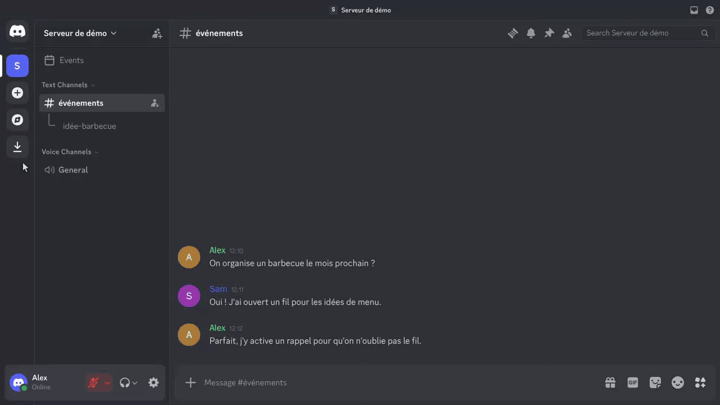
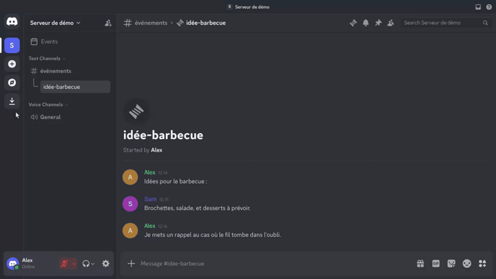
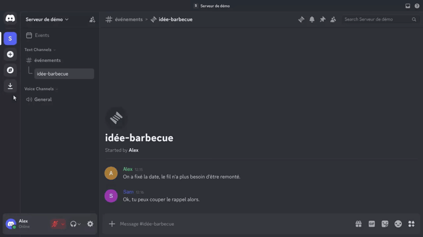

## Remind Workflow

The `/remind` command keeps forgotten Discord **threads** visible by posting a
short bump message when a thread stays quiet for too long.

### Intent

One automatic reminder per thread (shared by everyone on the server). The bot
checks about once an hour and only bumps a thread if its last message is older
than the configured idle period. The bump itself counts as activity, so the
thread will not be bumped again until it goes quiet for another full period.

### Thread only

`/remind` must be run **inside a thread**. In a normal text channel the bot
replies ephemerally with **Ahem... cette commande ne marche que dans un fil 🤷**.

### Menu

Anyone who can send messages runs `/remind`. The bot replies ephemerally with
**Que veux-tu faire ?** and a select:

- **Activer**
- **Statut**
- **Désactiver**

The ephemeral menu updates in place: after a choice, the select is replaced by
the next step or by the result.

### Activate

**Activer** opens a modal:

- **Jours d'inactivité** — integer from **1** to **30**, days of inactivity
  before a bump.

Success replaces the menu with **Ok! Je remonterai ce fil s'il reste silencieux
{days} jour(s) ;)**.

If a reminder is already active on that thread, the bot replies **Ahem... il y a
déjà un rappel sur ce fil 🤷** and does not open the modal. Turn it off first if
you need a different day count.

On an **archived** thread, **Activer** is refused with **Ahem... ce fil est
archivé, je ne peux pas y mettre de rappel 🤷**.

A value that is not an integer from 1 to 30 is refused with **Ahem... indique un
nombre de jours entre 1 et 30 🤷**.

### Status

**Statut** replaces the menu:

- inactive → **Ahem... pas de rappel sur ce fil 🤷**
- active → shows the idle threshold and who enabled it

### Deactivate

**Désactiver** soft-stops the reminder and removes the last **⬆️** bump in the
thread if it is still there. Only:

- the member who enabled it, or
- a moderator (Administrator, Manage Server, Manage Channels, Manage Messages,
  Kick Members, or Ban Members)

Success replies **Ok! Plus de rappel sur ce fil ;)**. Without a reminder, the
bot replies **Ahem... j'ai rien trouvé... 🤷**. Non-owners without moderator
rights get **Ahem... je ne suis pas habilité à le faire 🤷**.

### Automatic bump

When the idle threshold is reached, the bot posts **⬆️** in the thread. If a
previous bump message from the bot is still there, it is removed before the new
one is posted. If someone writes in the thread before the next bump is due, the
bot removes the last **⬆️** (if still present) and waits again from that
activity. If the thread has been **archived**, the reminder is removed instead
of bumping. No scenario video covers the hourly check — only the slash command
above.
