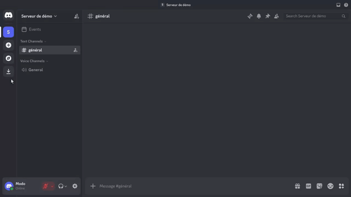
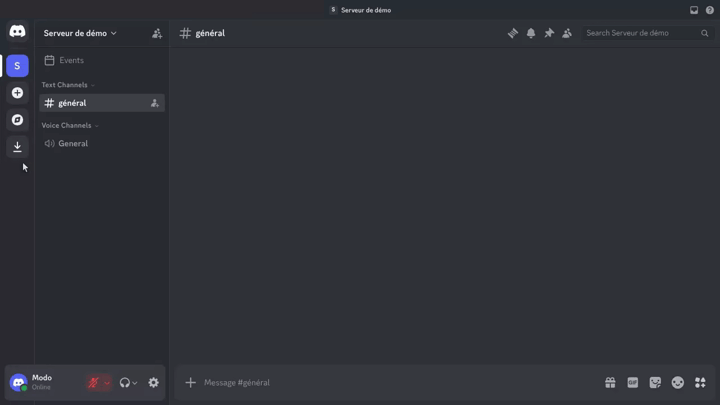
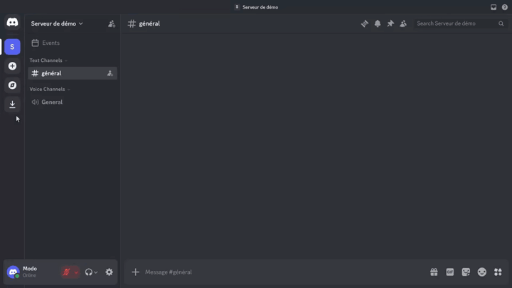
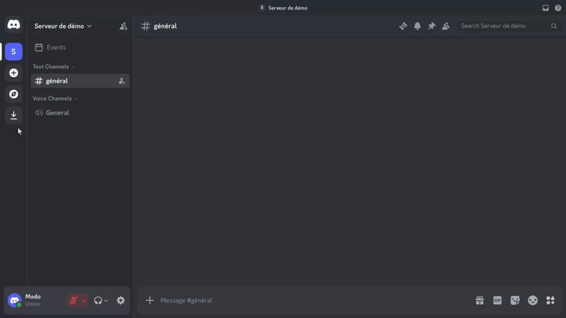

## Trigger automations

A **trigger** is an automation that runs in reaction to a Discord event. For
now, only **member join** is implemented.

`/trigger` lets moderators create and manage these automations. Today there
are two kinds (both on join):

| Kind                     | What happens on join                    |
| ------------------------ | --------------------------------------- |
| **Message de bienvenue** | Posts a message in a chosen channel     |
| **Rôle de bienvenue**    | Assigns a chosen role to the new member |

Each automation has a short **name**. You can keep several on the same server
(up to 10). A disabled automation stays configured but does not run until you
activate it again.

The ephemeral menu updates in place: after each select, the choice appears as
text and the next select (or the result) replaces the previous one.

### Permissions

`/trigger` requires a server channel and moderator permissions. The moderator
check accepts members with at least one of: Administrator, Manage Server,
Manage Channels, Manage Messages, Kick Members, or Ban Members.

Non-moderators receive an ephemeral **Ahem... je ne suis pas habilité à le
faire 🤷** response.

---

### Message de bienvenue

Posts a welcome text in a channel when someone joins.

**Flow**

1. Run `/trigger`.
2. Choose **Créer**, then **Message de bienvenue**.
3. Fill the modal:
   - **Nom de l'automatisme** — lowercase letters, digits, spaces, `_`, `-`,
     `.` — 1–50 characters;
   - **Salon du message** — where the bot will post;
   - **Message de bienvenue** — 1–2000 characters.
4. Submit. Success replies with the automation name and kind, for example
   **Automatisme "welcome" (Message de bienvenue) créé.** plus a
   **Prévisualiser** button.

**Preview:** a moderator who clicks **Prévisualiser** sees the interpolated
welcome text posted in the **same** channel (placeholders use the clicker).
Click again after further edits to preview the latest text.

**Placeholders** in the message text:

- `{user}` — mention of the new member
- `{username}` — display username
- `{server}` — server name

**Requirements:** the bot must **see** the target channel and have **Send
Messages** there. Otherwise setup fails with an ephemeral error (instead of
failing silently on join).



```text
/trigger → Créer → Message de bienvenue
         → modal: name=welcome, channel=#général, message=Bienvenue {user} !
         → confirmation + Prévisualiser
         → Modo clicks Prévisualiser → preview in this channel
```

When a member joins, the bot posts the configured message in the chosen
channel (placeholders are replaced):



```text
Alex joins #général
         → P'tit Pote: Bienvenue @Alex !
```

---

### Rôle de bienvenue

Assigns a role when someone joins.

**Flow**

1. Run `/trigger`.
2. Choose **Créer**, then **Rôle de bienvenue**.
3. Fill the modal:
   - **Nom de l'automatisme** — same naming rules as above;
   - **Rôle à attribuer** — the role given to new members.
4. Submit. Success replies with the automation name and kind, for example
   **Automatisme "member" (Rôle de bienvenue) créé.**

**Requirements:** the bot needs **Manage Roles**, and its highest role must sit
**above** the role it assigns (Server Settings → Roles). Otherwise Discord
returns Missing Access and the join role is skipped; setup also checks this
and can fail with an ephemeral error.



```text
/trigger → Créer → Rôle de bienvenue
         → modal: name=member, role=@Membre
```

---

### Manage automations

From the same `/trigger` menu:

- **Modifier** — change settings of an existing automation (name and enabled
  state stay the same). The modal preselects the current channel or role,
  and keeps the current welcome message. Success replies with
  **Automatisme "{name}" modifié.**
- **Activer** — turn a disabled automation back on. Success posts a public
  **Automatisme "{name}" activé.** (the ephemeral menu is dismissed).
- **Désactiver** — keep it configured but stop it from running on join.
  Success posts a public **Automatisme "{name}" désactivé.**
- **Supprimer** — remove it; the same name can be created again later.
  Success posts a public **Automatisme "{name}" supprimé.**

After you pick an action (except **Créer**), the message shows that action and
asks which automation in a second select. If none exist, the same message
shows **Ahem... j'ai rien trouvé... 🤷**.

If the name already exists when you **Créer**, the bot replies ephemerally
that it is already taken (no overwrite).



```text
/trigger → Désactiver → welcome
/trigger → Activer → welcome
/trigger → Supprimer → member
/trigger → Modifier → welcome → modal: new channel / message
```

---

### Constraints

- Guild-only: automations are managed per Discord server.
- Names are unique per server among non-deleted automations.
- Names may use lowercase letters, digits, spaces, `_`, `-`, and `.`.
- At most **10** non-deleted automations per server (disabled ones count).
  Creating another one replies ephemerally with **Ahem... ca fait beaucoup là.
  Non?**
- The bot needs the privileged **Server Members Intent** enabled in the
  Discord Developer Portal for join events to fire.
